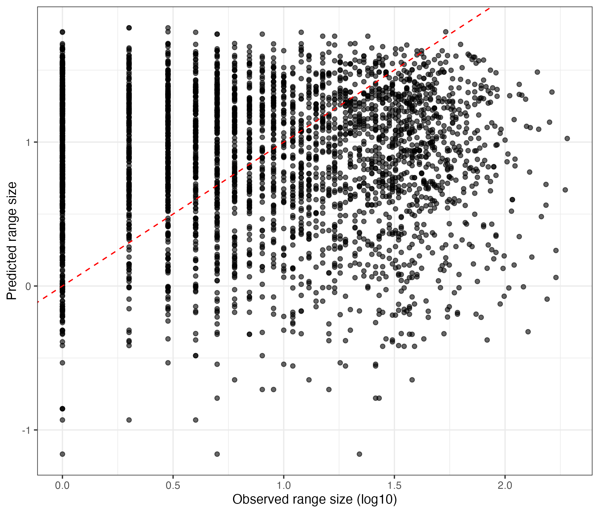

# Data information
I chose to work on regression problem on Bures et al 2024 supplemental data. I want to predict the range size of plant species based on its number of chromosome, genome size and climatic variables at where the species was found. 

| Variable | Description |
|---|---|
| `log10_range_size` | Our response variable - log10-transformed geographic range size |
| `log10_2C_genome.size` | Log10-transformed 2C genome size |
| `log10_mean_chromosome_size` | Log10-transformed mean chromosome size |
| `num_chr2n` | Diploid chromosome number |
| `Latitude` | Latitude |
| `Growth_form` | Plant growth form |
| `log10_occurence` | Log10-transformed occurrence |
| `Longitude` | Longitude |
| `Mean.aridity.index` | Mean aridity index |
| `Mean.BIO1` | Mean annual temperature from sea level |
| `Mean.BIO3` | Isothermality |
| `Mean.BIO7` | Annual temperature range |
| `Mean.BIO12` | Annual precipitation |
| `Mean.BIO15` | Precipitation seasonality |
| `Mean.BIO19` | Precipitation of the coldest quarter |
| `Mean.GSL` | Growing season length |
| `Mean.GST` | Temperature during growing seasons |
| `Mean.NGD5` | Number of days with temperature more than 5C |
| `Mean.UVB1` | UVA |
| `Mean.UVB3` | UVB |
| `Mean.UVB5` | UV in general (not really sure tho) |

# Models and their performance on training set
Models that I tried are random forest and bagging, and new models are pcaNNet, glmnet, and svmLinear2, quantified performance using RMSE (Root Mean Square Error) and the stats of that statistic across folds is also reported in the table below.

| Model | RMSE | RMSE SD | R-squared |
|---|---:|---:|---:|
| pcaNNet | 0.3977564 | 0.005188752 | 0.6742124 |
| glmnet | 0.3374579 | 0.010255900 | 0.6708281 |
| svmLinear2 | 0.3439794 | 0.011571164 | 0.6684044 |

Cross-validation RMSE comparison: [view the plot](RangeSizeModelComparison.pdf). 

(should have saved that as png...)

Best model is glmnet with the lowest RMSE, marginally.

So I fine-tuned glmnet with more n_iter (from 5 to 10) and get the tuning grid. The performance on more intensive tuning version does not improve, so perhaps we won't need to go further. 

# On test set 
Using that tuning model as a final version on test set, the statistic of the final model on the test data is RMSE = 0.3430839 and R-squared = 0.6609148, which is slightly worse than the cross-validated value (RMSE = 0.3374579 += 0.01 and R-squared = 0.6708281). I'd happy that the model is not overfitting and the performance is still acceptable to me.

add the plot of predicted vs observed values on test set: 

.

# Some thoughts

I also tried krlsPoly and gamboost but they took too long and problematic so changed. 

One thing to note here is I kinda know another version of glm (or in this case we are considering glmnet), which is pgls, Phylogenetic Generalized Linear Model, since I was trying to correct for phylogeny when examining relationship, and ordinary least square obviously was not sufficient in that case. I guess the general idea of gls is doing generalized least squared where it use regularization matrix to factor in colinearity that linear regression only can't do, and our data have bioclimatic variables (some columns represent temperature and some for precipitation) and also genome size and number of chromosome, etc., so to me it makes sense why glm-related ones are good models in this case. I'm more curious why svmLinear2 and pcaNNet can not beat glmnet, because to me glm is more "basic" and sometimes can not handle extreme values pretty well such as in our latitude column, but their RMSE values are not that different anyway - might be because they are both linear models. 

If I could fix the issue with the parallel thing when runnign it locally, I'd love to try the polynomial thing out again, as the original study actually detected the polynomial relationship. I guess that also explains why our models did not have RMSE low (~0.3 is not low to me though), since linear models as we had is not an optimal way to do it. But it's still interesting to know that it did not perform terribly. 
