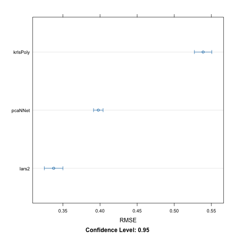
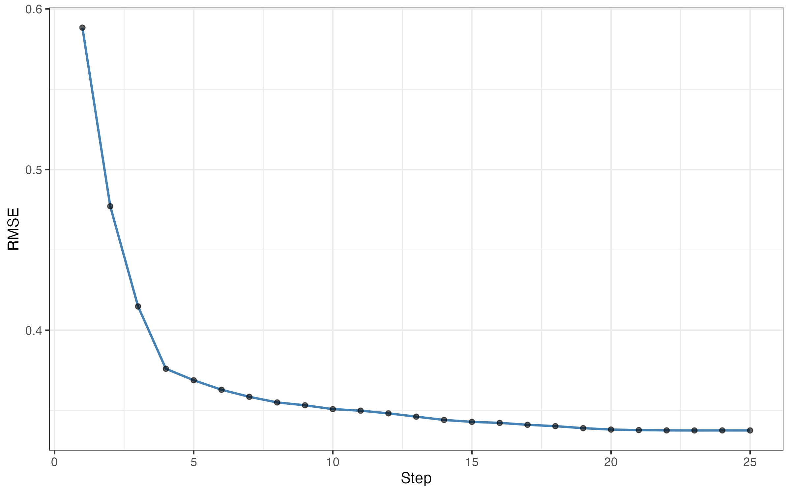
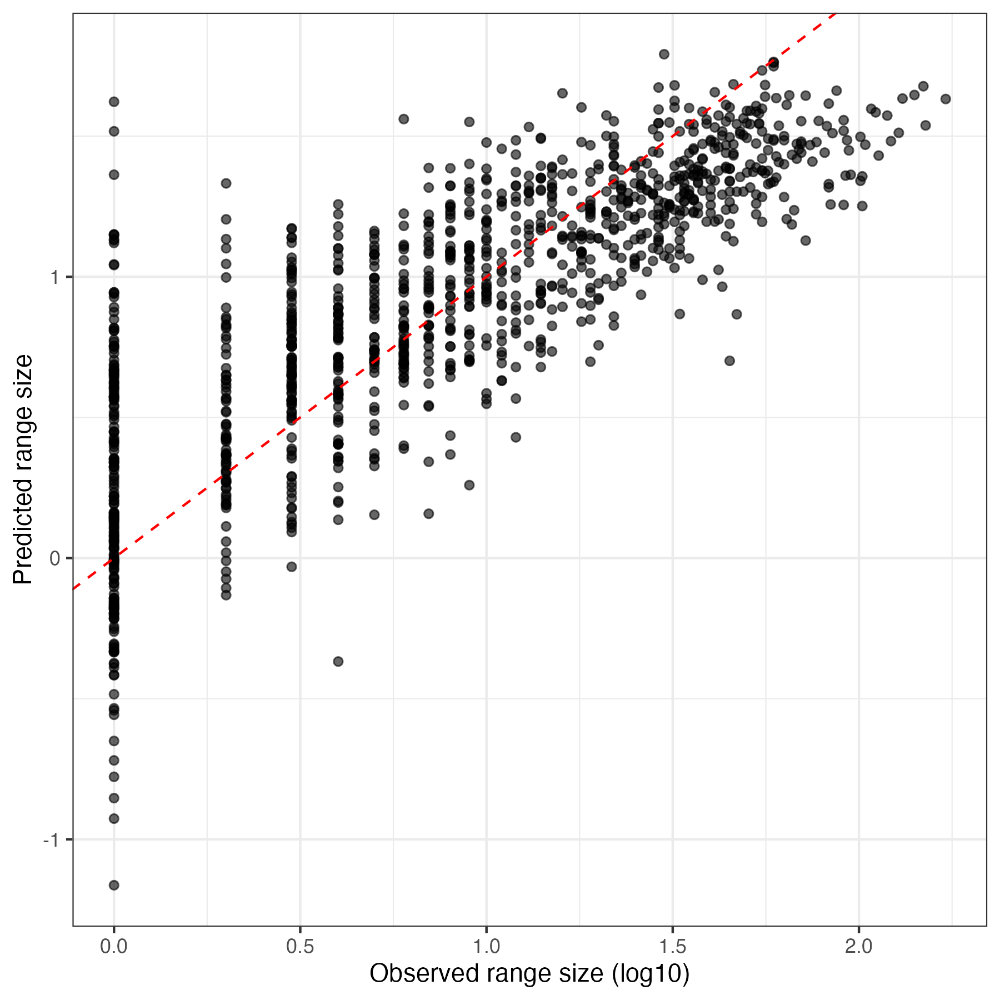

# Data information
I chose to work on regression problem on [Bures et al 2024](https://nph.onlinelibrary.wiley.com/doi/full/10.1111/nph.19544) supplemental data. I want to predict the range size of plant species based on its number of chromosome, genome size and climatic variables at where the species was found. 

| Variable | Description |
|---|---|
| `log10_range_size` | Our response variable - log10-transformed geographic range size |
| `log10_2C_genome.size` | Log10-transformed 2C genome size |
| `log10_mean_chromosome_size` | Log10-transformed mean chromosome size |
| `num_chr2n` | Diploid chromosome number |
| `Latitude` | Latitude |
| `Growth_form` | Plant growth form |
| `log10_occurence` | Log10-transformed occurrence |
| `Longitude` | Longitude |
| `Mean.aridity.index` | Mean aridity index |
| `Mean.BIO1` | Mean annual temperature from sea level |
| `Mean.BIO3` | Isothermality |
| `Mean.BIO7` | Annual temperature range |
| `Mean.BIO12` | Annual precipitation |
| `Mean.BIO15` | Precipitation seasonality |
| `Mean.BIO19` | Precipitation of the coldest quarter |
| `Mean.GSL` | Growing season length |
| `Mean.GST` | Temperature during growing seasons |
| `Mean.NGD5` | Number of days with temperature more than 5C |
| `Mean.UVB1` | UVA |
| `Mean.UVB3` | UVB |
| `Mean.UVB5` | UV in general (not really sure tho) |

# Models and their performance on training set
Models that I tried are random forest and bagging, and new models are pcaNNet, krlsPoly, and lars2, quantified performance using RMSE (Root Mean Square Error) and the stats of that statistic across folds is also reported in the table below.

| Model | RMSE | RMSE SD | R-squared |
|---|---:|---:|---:|
| lars2 | 0.3376186 | 0.010093306 | 0.6705192 |
| pcaNNet | 0.3977564 | 0.005188752 | 0.6742124 |
| krlsPoly | 0.5388771 | 0.009460121 | 0.5580677 |

Cross-validation RMSE comparison: . 

After training on train set with cross validation of 5 rounds, the best model is lars2 with the lowest RMSE. So I fine-tuned lars2 with the tuning grid with 25 steps to find the lowest RMSE until it starts increasing RMSE. The performance on more intensive tuning version does not improve, so perhaps we won't need to go further. 

Distribution of RMSE after each step while tuning lars2 

The lowest step in tuning lars2 is step 23, which is marginally lower than step 22 and 24 with RMSE of 0.338 +- 0.01. Interestingly, this RMSE is not improved compared to intial train set, which to me, might not worth the effort of tuning 25 steps. 

# On test set 
Using that tuning model as a final version on test set, the statistic of the final model on the test data is RMSE = 0.3430481 and R-squared = 0.661, which is slightly worse than the cross-validated value. We expect this scenario, and with the RMSE did not get too bad, I'm happy with the this model.

Plot of predicted vs observed values on test set: 

# Some thoughts

I also tried gamboost but it took too long and problematic so I did not report here. Also, krlsPoly actually will take a lot of CPU and time to run, and I could not make the parallel process work locally on my laptop. 

Our best model is lars2 (Least Angle Regression), so I read more about it to know how it actually works and why it outperforms other methods. It's a regression model that used to identify predictors that are important to the range size by adjusting its coefficient after each step. 

It was unexpected to me that lars2 works best. The original study detected the polynomial relationship between genome size and some bioclimatic variables, as well as negative linear relationship between genome size and range size, so I hypothesized that range size would have polynomial relationship with climates and krlsPoly would perform best here. However, it turns out lars2, which is a linear model, did better. One explanation can be because of multicollinearity of climatic variables, that temperature, precipitation and growing season length might have influences on each other, so krlsPoly and pcaNNet might be too detailed and the data itself did not harbor that much "good" information to learn from. However, for lars2, since it just focused on important variables, perhaps it can reduce error from noise better than the rest.  

