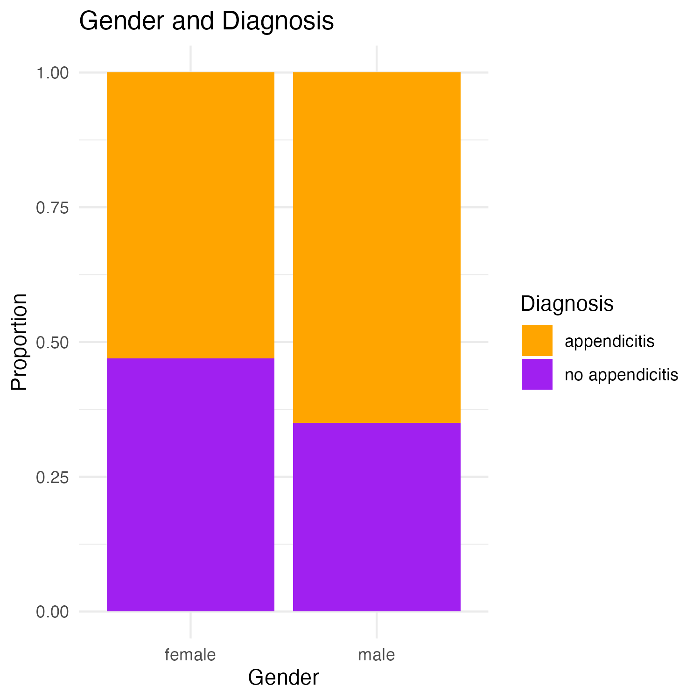
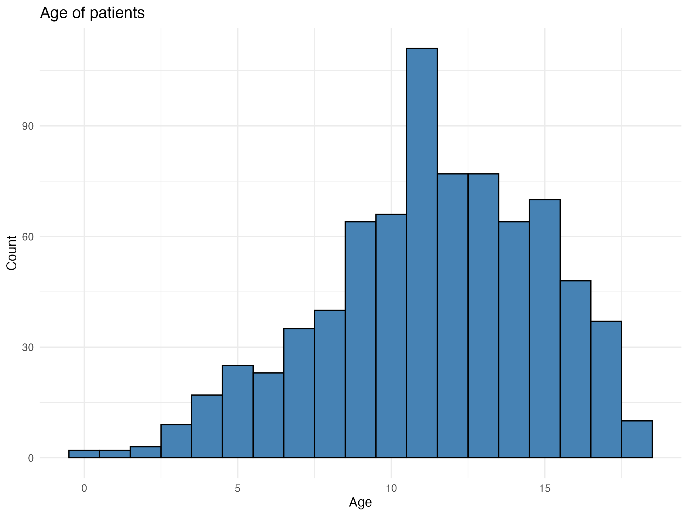
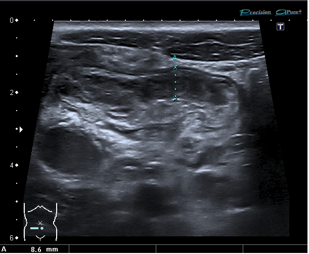

# Prediction of pediatric appendicitis using machine learning methods
Linh Nguyen \
BIOL 701 - Final project

## Background 
Appendicitis is an emergency inflammation of the appendix and among the most frequent reasons for pediatric abdominal surgeries. Children with unclear abnomial issues, are highly likely to have appendicitis, especially ones at ages 10-11. However, it is challenging to diagnosis pediatric appendicitis and relies on different methods such as patient physical examination and laboratory tests, as well as visually inspect ultrasound images. Yet, the effectiveness of using them as biomarkers for early detection vary. 

With the development of machine learning methods, we can combine different perspectives to improve the accuracy of diagnosis. By integrating demographic information, laboratory tests, and ultrasound images, we can create a more comprehensive model for predicting pediatric appendicitis. My goal for this project is to find out if we can predict pediatric appendicitis using machine learning methods from demographic, laboratory tests and ultrasound images.

## Materials and methods
Dataset was collected and anonymized by Children’s Hospital St. Hedwig in Regensburg, Germany (https://arxiv.org/pdf/2302.14460v2). It contains demographic information of patients, multiple ultrasound images of abdominal B-mode along with encompassing laboratory tests, physical examination results, clinical scores of each patient.

Prediction of diagnosis (appendicitis vs. no appendicitis) will be examined on 782 patients through 53 features (demographics, physicale examination and lab results). Since there are some features and patients with missing values, so I clean them up and the final dataset has 780 patients with 37 features. 

Distribution of gender and diagnosis with appendicitis or not

Also distribution of patients' ages:

Besides, we also have ultrasound images (in .bmp format) and I want to use neural network to classify if images were from patient with appendicitis or not. 

An example of the ultrasound image, before any cleaning or preprocessing.

Diagnosis will be predicted using classification tools since we have 2 types of diagnosis only (appendicitis and no appendicitis). I will apply logistic regression, knn, support vector machine and random forest on this task. Then, classification of ultrasound images will be done using neural network approach and finetuning the pre-trained model.  

## Some thoughts 
I think classification task will be achieveable with 780 observations and 37 features. For image classification, there might be some issues that I can think of so far:
- Images need to be cleaned up, cropped, annotated/labeled to patients (based on the file name) - before being processed (reshaped etc) for training
- Neural network architecture - I'm thinking of using relu then dropout three times then softmax, but I feel like with that we'll just get low accuracy. But having more layers might not be good either, so I need to do some research on that. I'll try to fine tune with pre-trained model (maybe ResNet-18 - https://github.com/983632847/USCL) to classify images.
- Also time constraint too 

However, I think this dataset is interesting and I'm curious how well the models will perform - really look forward to working on it. 

